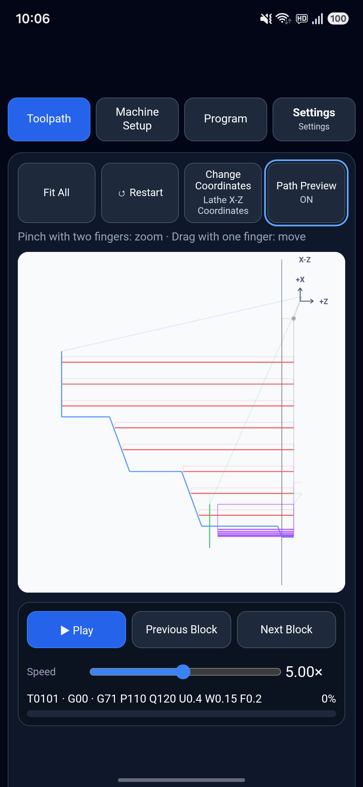
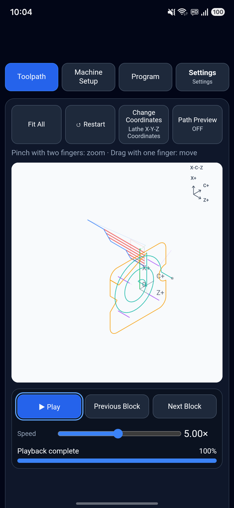
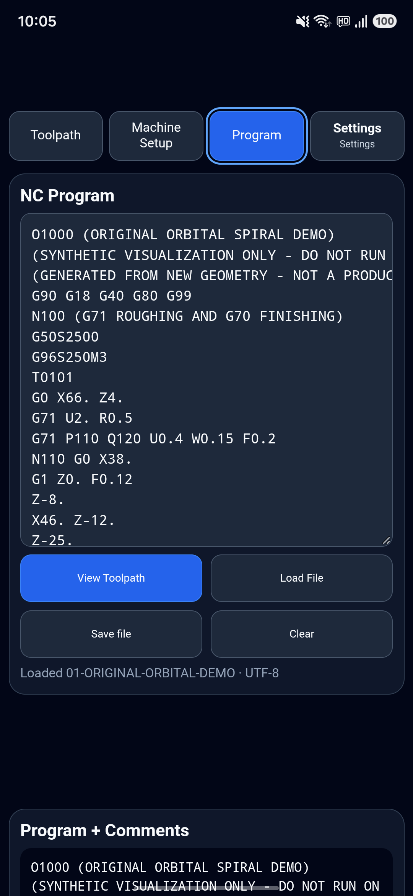

# CNC Path Analyzer / G Code Simulator

An Android app for viewing supported CNC lathe and milling G-code toolpaths, following program blocks, and exploring machining paths on your phone.

[Download on Google Play](https://play.google.com/store/apps/details?id=com.cjh8838.cncpathanalyzer)

This is the public introduction and feedback repository. The Android application source code is not included, and this is not an open-source release of the app.

## Why I built it

Hello, fellow machinists! I am still learning CNC machining. When editing a program at the machine, I sometimes found it difficult to picture how the tool would move after a change. So I built CNC Path Analyzer / G Code Simulator to help me explore those paths.

I would really appreciate feedback from people with more shop-floor experience. If something is confusing or a feature could be improved, please let me know.

## Demo

[Watch the app demonstration](media/cnc-path-analyzer-demo.mp4)

The demonstration shows a lathe program, turning off path preview, playback at 1× followed by 5×, and loading another example to explore its three-dimensional path.

## Screenshots

### Lathe toolpath

### Three dimensional toolpath

### Program and file loading

## What you can do

- Load an NC program and view supported lathe and milling toolpaths.
- Show the full path or turn off preview to follow playback progressively.
- Play, pause, change playback speed, and step through program blocks.
- Jump to a selected program block or a tool's starting point.
- Inspect paths with zoom, movement, and available coordinate views.
- View estimated machining time when the required program information is available.

## Getting started

1. Install the app from Google Play.
2. Open the Program tab and enter a simple example or load an NC file.
3. Choose the machining mode that matches your program when prompted.
4. Open the toolpath view and use the full-path view to orient yourself.
5. Turn off path preview to watch the path appear during playback, or step through blocks individually.

## Support and limitations

This is a reference tool for supported G-code paths, not a machine controller, collision detector, or machining safety verification system. It does not reproduce every controller-specific command, machine configuration, offset, or machining condition. Estimated machining time is an approximation, not a production guarantee.

Always independently verify the original program and machine setup before running a real machine. A displayed path does not establish that a program is safe to run.

## Feedback

[Open an issue](https://github.com/cjh8838a/cnc-path-analyzer/issues/new) to suggest an improvement or report unexpected behavior. Please include:

- App version, Android version, and device model.
- Steps to reproduce the issue and the expected result.
- A screenshot or a small, synthetic G-code example if useful.

Issues are public. Do not upload customer programs, confidential drawings, personal information, or proprietary production data.

To everyone machining on the shop floor today: stay safe, and keep up the great work!
